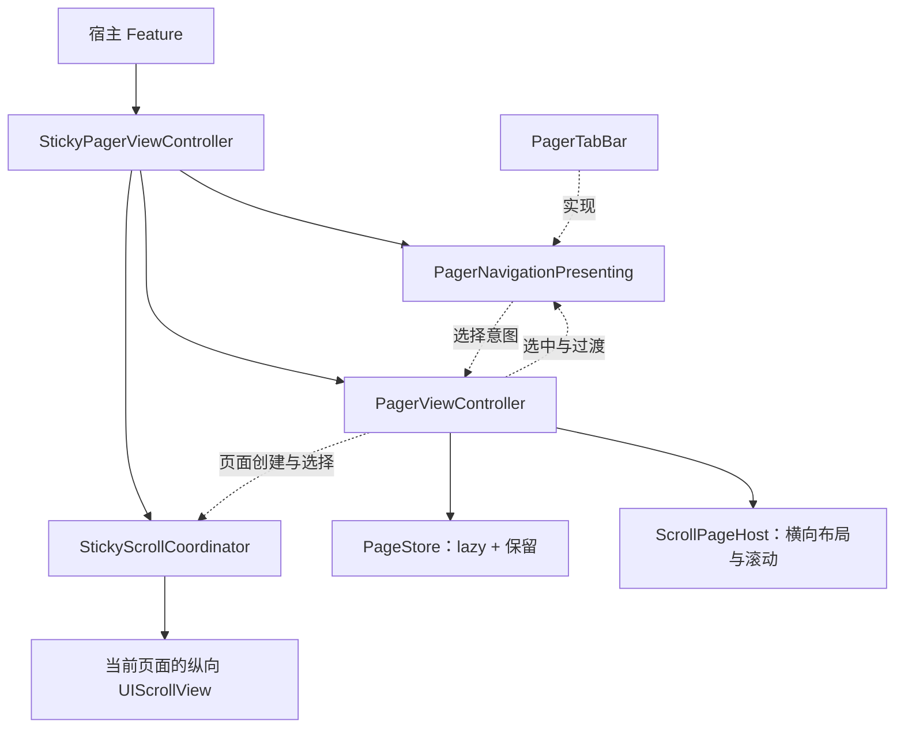

# Pager

UIKit / iOS 16。Swift 6 language mode，开启完整并发检查；UI 状态显式隔离到 MainActor，无新增依赖。首版采用 UIScrollView，按 Id 懒创建后全部保留页面；不会因为普通切页回收页面或自动请求数据。

## 入口与归属

- `PagerViewController`：横向分页、选择、过渡、页面实例和子 VC 生命周期。
- `PagerNavigationPresenting`：导航视图协议，要求 `Self: UIView`；提供页面身份、选择意图、已提交选择与过渡展示。
- `PagerTabBar`：协议的默认实现，负责标题、按钮、样式和指示器。
- `StickyPagerViewController`：公共头部、分类栏与分页的吸顶组合。
- Feature：页面内容、网络请求、业务数据、刷新控件及刷新状态。



普通 Pager 不要求页面包含列表。未来 Collection 承载应实现相同的滚动与挂载边界，继续复用页面身份、存储与生命周期规则；本期没有未实现的承载枚举或 LRU 配置。

## 普通分页

```swift
let pager = PagerViewController(pages: [
    PagerPage(id: "featured") { FeaturedViewController() },
    PagerPage(id: "discover") { DiscoverViewController() },
])
pager.selectPage("discover", animated: true)
```

调用方按 UIKit 标准 `addChild` / 添加 view / `didMove` 完成容器接入。页面工厂必须返回专属于该 Id、尚无 parent 的 VC，不应在工厂中重入 Pager 操作。页面按传入数组从左到右排列；RTL 页面顺序由宿主提供。

`PagerViewControllerDelegate` 接收 `PagerEvent`，回调的 pager 参数为 `any PagerControlling`。普通分类栏可在 delegate 中调用 `tabBar.receive(event)`，并让 `tabBar.onSelect` 调用 `pager.selectPage`。也可以提供完全自定义的导航 UI，只消费这些事件。

初始化为非 Optional、非抛出调用。初始 Id 唯一性、选中 Id 的成员关系、组合容器页面与导航顺序一致性均由调用方保证，不通过断言、Optional 或自动清空配置处理错误输入。页面工厂、视图归属及有限非负高度同样属于调用契约，不添加 `precondition` / `assert`，也不为错误实现提供恢复逻辑。运行时 `setPages` / `setItems` 的普通输入拒绝仍保留校验和日志。

## 选择与保留契约

- `selectedPageId` 是已提交选择，拖动中保持源页 Id；仅完成切换后提交目标页。
- 子页面生命周期或事件回调中触发父容器离场，不会跳过子页面 appearance。正在转发生命周期时，父容器通知会暂存到当前交接过程结束，再按顺序同步处理，避免在 UIKit 的 begin/end 调用栈中重入同一组 appearance。刚开始的切页可被取消；已经提交完成结果的切页先闭合，再转发选中页面离场。每次切页只发布一个结束结果。`setPages` 的子页面交接也使用相同保护。
- 切换事件：`willTransition` → 零到多次 `didUpdateTransition` → `didFinishTransition(completed:)`。完成后另发 `didSelect`；取消不发选择事件。
- 首次选择通过初始化属性读取，不额外发送初始化回调。`setPages` 改变选择时发 `didSelect`，不伪造横向过渡。
- 手势反向、尺寸变化和父容器离场可能取消未完成切换；appearance 回到已提交页面。
- 相邻页面在可见时支持程序化动画。跨多页跳转直接定位，避免创建中间页面。
- 事件回调中的选择请求合并为最后一次，在当前操作完成后的主线程下一轮处理。父容器 appearance 期间同样延后。
- `setPages` / `setItems` 返回可忽略的 Bool：false 表示输入或时机被拒绝，内部记录日志，不修改旧状态；true 表示更新已提交。`setPages` 校验重复 Id 和无效选中 Id；过渡、拖动、减速、事件回调或父容器 appearance 期间拒绝更新。公开 API 不抛出错误。
- `selectPage` 的 true 只表示请求被接受，重入时可能延后或被较新请求替代；完成与取消通过事件通知。未知 Id 返回 false 并记录日志。
- 相同 Id 保留原 VC，新 descriptor 的工厂不会重新运行；需要替换内容 VC 时使用新的 Id。
- 移除 Id 会移除 child、view 和存储引用。保留的页面始终挂载，不把视图移出层级当作缓存策略。
- 非当前页面从辅助功能树隐藏；选中页参与状态栏样式转发。切页完成或 `setPages` 改变/清空选择时，先请求状态栏更新，再发布选择事件。

## 分类栏

`PagerNavigationPresenting` 保留 `where Self: UIView` 约束。实现提供有序 `pageIds`、`onSelect`、`setSelection` 与 `displayTransition`。`receive(_:)` 在协议扩展中统一分发事件，并在切换取消时恢复源页选择。展示状态时不能反向触发 `onSelect`；`setSelection` 必须清除正在展示的过渡。容器在加载视图时安装 `onSelect`，并负责导航视图的 frame；内部布局和展示数据由实现管理。

`PagerTabBar.Item` 提供 Id、标题、可选 accessibilityLabel。`Configuration` 提供字体、颜色、间距、内容边距、最小 item 宽度、分布方式、indicator 宽度/高度与底部间距。业务样式由调用方注入，没有首页/Story 模式分支。

点击不会自行提交选中状态，宿主调用 `setSelection` 或转发 Pager 事件。`displayTransition` 驱动 indicator 的位置和宽度插值。长标题可横向滚动；选中项自动进入可视范围。

## 吸顶接入

```swift
let sticky = StickyPagerViewController(
    pages: pages,
    items: items, // Id 和顺序必须与 pages 一致
    headerView: headerView,
    headerHeight: 200,
    scrollViewProvider: { _, controller in
        (controller as! FeedViewController).tableView
    }
)
```

默认入口推导为 `StickyPagerViewController<PagerTabBar>`；显式声明属性或返回类型时需要写出导航类型。容器保留具体类型，因此仍可直接访问 `sticky.tabBar.configuration`，默认实现的 `items:` 入口只对 `PagerTabBar` 可用。

自定义 UI 实现 `PagerNavigationPresenting` 后，先配置内容，再注入同一实例：

```swift
let navigation = FeedNavigationView() // UIView & PagerNavigationPresenting
navigation.configure(categories)
let sticky = StickyPagerViewController(
    pages: pages,
    tabBar: navigation,
    headerView: headerView,
    headerHeight: 200,
    scrollViewProvider: { _, controller in
        (controller as! FeedViewController).tableView
    }
)
```

初始化时 `navigation.pageIds` 必须与 pages 的 Id、顺序完全一致。选中项由容器同步，不要求外部自行推导默认选择。标题、图片和角标等展示模型无需遵循框架类型。

上例的类型转换只属于已知页面类型的宿主。框架不扫描视图树来猜主列表，也不要求普通 Pager 的 VC 继承特定基类。

纵向接入约束：

- 返回页面自己拥有、填满页面 viewport 的 UITableView、UICollectionView 或 UIScrollView；主要列表不再嵌套在另一纵向滚动容器内。
- 外层组合入口处理 safe area；接入期间列表采用 `.never` 自动 inset 调整。它的 delegate 保持业务所有。
- 接入前的 `contentInset` 作为业务基值。接入后需要改变业务 padding 时调用 `setContentInset(_:for:)`，不要直接覆盖框架拥有的贡献。
- 框架的实际 top inset 贡献为「尚未收起的公共头部 + 分类栏」，随列表滚动同步变化，使 UITableView plain section header 和 UICollectionViewFlowLayout 的原生吸顶区头紧接分类栏。完全展开时的位置基准单独保留，用于共享收起量、阅读位置和解除接入；修改 inset 时保持 contentOffset。短/空列表仍补足 bottom inset，不改写 `contentSize` 或关闭列表估算高度。
- UIRefreshControl 的临时 inset 与框架贡献分开：框架只修改自己的增量。
- 主列表的 `contentOffset` / `contentSize` 必须按 UIKit 规则在主线程修改；同步 KVO 回调在此不变量下进入 MainActor。
- 公共头部和分类栏通常放在当前列表中，因此从头部开始拖动也使用列表原生滚动。横向过渡时临时移动到安全区内的覆盖容器，结束后移回选中列表。
- 公共头部高度是显式输入，业务测量变化后调用 `setHeaderHeight`。吸顶后的内容阅读距离在高度变更时保持。

### 切页位置

头部完全收起时，返回已有页面保留其深处阅读位置；新页面至少对齐吸顶位置。头部展开时，共享头部位置优先，目标列表对齐公共头部，覆盖它之前的深处偏移。不会承诺公共头部保持展开且深处阅读偏移同时不变。

### 刷新

Feature 在自己的主列表上安装 UIRefreshControl，处理 `.valueChanged` 并调用 `endRefreshing()`。不刷新公共头部，不因页面 appearance 发请求。列表回到顶部、公共头部完全展开后，继续下拉时公共头部与分类栏保持原位，列表内容下移，原生刷新指示器显示在分类栏与列表内容之间。

刷新中允许切换页面；返回刷新中的页面不强制重设其偏移。自定义刷新库并未逐一适配，不能直接假定与 UIRefreshControl 相同。

### 清理

移除页面立即取消观察并移除框架的 inset 贡献，恢复原来的 adjustment、bounce 与 scrollsToTop 设置。容器释放时把清理安排到下一轮主队列；显式移除页面则立即清理。若旧容器已释放而列表立即接入新容器，新接入会先同步恢复旧接入的配置和 inset 贡献，再记录新的初始状态；旧异步清理随后不再改动该列表。同一列表不能同时归两个存活的吸顶容器管理。每个时刻仅当前主列表参与 scroll-to-top。

`sticky.pager` 以 `any PagerControlling` 暴露选择、pageIds、当前页、过渡状态、滑动开关与 delegate，不暴露 `setPages` 或 UIViewController 的加载/挂载方法。delegate 参数使用相同协议，具体类仍 weak 持有 delegate。`selectPage(id)` 的默认动画便利调用由协议扩展提供；独立 `PagerViewController` 保留公开 `setPages`。这是防止常规误用的静态接口，不禁止主动强转或通过 UIKit 对象树访问内部控制器。

组合容器更新页面使用自身 `setPages(_:items:selectedPageId:)`，保证页面与分类项同步；不要绕过它直接替换内部 pager 的页面。更新失败时两者都不改变；同步发布 `.didSelect` 前，分类项、选中项和列表接入状态已经完成更新，回调中的重入规则与普通 Pager 一致。

自定义导航更新内容使用带 `navigationPageIds` 的入口。页面和导航身份、选择以及当前过渡状态全部校验通过后，框架才调用 `updateNavigation`；该闭包必须同步安装声明的有序 Id，且不能失败或发出选择意图。框架随后应用选中状态，再发布事件。校验失败时闭包不会执行。实际实现是否正确安装这些 Id 由业务保证，框架不在提交后用断言终止或返回 false；也不承诺回滚任意配置闭包的副作用。

```swift
sticky.setPages(newPages, navigationPageIds: newCategories.map(\.id)) { navigation in
    navigation.configure(newCategories)
}
```

`configure` 是业务视图自己的非抛出配置方法。需要失败校验的数据先在外部准备好，不要在调用 `setPages` 前修改已挂载的导航内容。同一组导航项只更新页面描述或选择时，可直接调用 `sticky.setPages(newPages, selectedPageId: id)`；该入口会校验现有 `pageIds`。

允许在组合容器加载前调用 `sticky.pager.selectPage`；公开控制协议不再提供 `loadViewIfNeeded`。外层加载时会补接所有已创建页面，并同步实际选择；不会重复运行页面工厂。

分类栏在设置条目或选择后，等有效尺寸下的按钮布局完成再显示选中项。该显示请求只消费一次，后续 indicator 进度更新不会覆盖用户手动滚动分类栏的位置。

横向过渡期间更新头部高度，列表与 overlay 同时使用新的几何；吸顶位置、收起比例和下拉距离分别保持。

## 验证与样例

单元测试位于 `Tests/PagerTests`，覆盖页面身份/保留、生命周期完成与取消、重入、移除、布局变化、吸顶与阅读位置、短列表、inset 所有权和清理。

包内 `Examples/PagerDemo/PagerDemo.xcodeproj` 只依赖本地 Package，包含长/短/空列表、头部高度切换、原生刷新与 XCUITest。它不依赖任何宿主 App。

本轮参考了 JXSegmentedView、JXPagingSmoothView、GKPageSmoothView 和 Parchment 的职责划分与滚动思路；当前实现独立编写，没有引入这些库或复制其源码。开源采用仓库已有的 Apache-2.0 许可证。

SwiftUI 宿主兼容性由示例内的 `PagerDemoHost` 与 UI 测试验证，核心库没有承诺 SwiftUI List 内部滚动视图适配。
