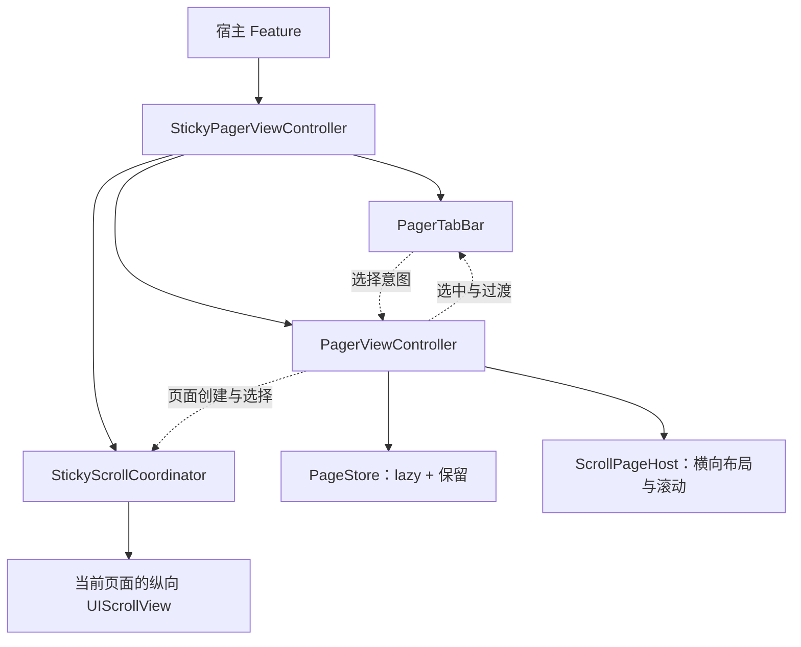

# Pager

UIKit / iOS 15。Swift 6 language mode，开启完整并发检查；UI 状态显式隔离到 MainActor，无新增依赖。首版采用 UIScrollView，按 ID 懒创建后全部保留页面；不会因为普通切页回收页面或自动请求数据。

## 入口与归属

- `PagerViewController`：横向分页、选择、过渡、页面实例和子 VC 生命周期。
- `PagerTabBar`：独立分类栏，点击发出意图，显示已提交选择和过渡进度。
- `StickyPagerViewController`：公共头部、分类栏与分页的吸顶组合。
- Feature：页面内容、网络请求、业务数据、刷新控件及刷新状态。



普通 Pager 不要求页面包含列表。未来 Collection 承载应实现相同的滚动与挂载边界，继续复用页面身份、存储与生命周期规则；本期没有未实现的承载枚举或 LRU 配置。

## 普通分页

```swift
let pager = try PagerViewController(pages: [
    PagerPage(id: "featured") { FeaturedViewController() },
    PagerPage(id: "discover") { DiscoverViewController() },
])
pager.selectPage("discover", animated: true)
```

调用方按 UIKit 标准 `addChild` / 添加 view / `didMove` 完成容器接入。页面工厂必须返回专属于该 ID、尚无 parent 的 VC，不应在工厂中重入 Pager 操作。页面按传入数组从左到右排列；RTL 页面顺序由宿主提供。

`PagerViewControllerDelegate` 接收 `PagerEvent`。普通分类栏可在 delegate 中调用 `tabBar.receive(event)`，并让 `tabBar.onSelect` 调用 `pager.selectPage`。也可以提供完全自定义的导航 UI，只消费这些事件。

## 选择与保留契约

- `selectedPageID` 是已提交选择，拖动中保持源页 ID；仅完成切换后提交目标页。
- 切换事件：`willTransition` → 零到多次 `didUpdateTransition` → `didFinishTransition(completed:)`。完成后另发 `didSelect`；取消不发选择事件。
- 首次选择通过初始化属性读取，不额外发送初始化回调。`setPages` 改变选择时发 `didSelect`，不伪造横向过渡。
- 手势反向、尺寸变化和父容器离场可能取消未完成切换；appearance 回到已提交页面。
- 相邻页面在可见时支持程序化动画。跨多页跳转直接定位，避免创建中间页面。
- 事件回调中的选择请求合并为最后一次，在当前操作完成后的主线程下一轮处理。父容器 appearance 期间同样延后。
- `setPages` 校验重复 ID 和无效选中 ID；校验失败不改变数据。过渡、拖动、减速、事件回调或父容器 appearance 期间返回 `transitionInProgress`。
- 相同 ID 保留原 VC，新 descriptor 的工厂不会重新运行；需要替换内容 VC 时使用新的 ID。
- 移除 ID 会移除 child、view 和存储引用。保留的页面始终挂载，不把视图移出层级当作缓存策略。
- 非当前页面从辅助功能树隐藏；选中页参与状态栏样式转发。

## 分类栏

`PagerTabBar.Item` 提供 ID、标题、可选 accessibilityLabel。`Configuration` 提供字体、颜色、间距、内容边距、最小 item 宽度、分布方式、indicator 宽度/高度与底部间距。业务样式由调用方注入，没有首页/Story 模式分支。

点击不会自行提交选中状态，宿主调用 `setSelection` 或转发 Pager 事件。`displayTransition` 驱动 indicator 的位置和宽度插值。长标题可横向滚动；选中项自动进入可视范围。

## 吸顶接入

```swift
let sticky = try StickyPagerViewController(
    pages: pages,
    items: items, // ID 和顺序必须与 pages 一致
    headerView: headerView,
    headerHeight: 200,
    scrollViewProvider: { _, controller in
        (controller as! FeedViewController).tableView
    }
)
```

上例的类型转换只属于已知页面类型的宿主。框架不扫描视图树来猜主列表，也不要求普通 Pager 的 VC 继承特定基类。

纵向接入约束：

- 返回页面自己拥有、填满页面 viewport 的 UITableView、UICollectionView 或 UIScrollView；主要列表不再嵌套在另一纵向滚动容器内。
- 外层组合入口处理 safe area；接入期间列表采用 `.never` 自动 inset 调整。它的 delegate 保持业务所有。
- 接入前的 `contentInset` 作为业务基值。接入后需要改变业务 padding 时调用 `setContentInset(_:for:)`，不要直接覆盖框架拥有的贡献。
- 框架增加公共头部与分类栏的 top inset，并为短/空列表补足 bottom inset。不会改写 `contentSize` 或关闭列表估算高度。
- UIRefreshControl 的临时 inset 与框架贡献分开：框架只修改自己的增量。
- 主列表的 `contentOffset` / `contentSize` 必须按 UIKit 规则在主线程修改；同步 KVO 回调在此不变量下进入 MainActor。
- 公共头部和分类栏通常放在当前列表中，因此从头部开始拖动也使用列表原生滚动。横向过渡时临时移动到安全区内的覆盖容器，结束后移回选中列表。
- 公共头部高度是显式输入，业务测量变化后调用 `setHeaderHeight`。吸顶后的内容阅读距离在高度变更时保持。

### 切页位置

头部完全收起时，返回已有页面保留其深处阅读位置；新页面至少对齐吸顶位置。头部展开时，共享头部位置优先，目标列表对齐公共头部，覆盖它之前的深处偏移。不会承诺公共头部保持展开且深处阅读偏移同时不变。

### 刷新

Feature 在自己的主列表上安装 UIRefreshControl，处理 `.valueChanged` 并调用 `endRefreshing()`。不刷新公共头部，不因页面 appearance 发请求。列表回到顶部、公共头部完全展开后，继续下拉进入原生刷新区。

刷新中允许切换页面；返回刷新中的页面不强制重设其偏移。自定义刷新库并未逐一适配，不能直接假定与 UIRefreshControl 相同。

### 清理

移除页面立即取消观察并移除框架的 inset 贡献，恢复原来的 adjustment、bounce 与 scrollsToTop 设置。容器释放时在主线程清理；若最后一次释放来自非隔离上下文，清理安排到下一轮主队列。每个时刻仅当前主列表参与 scroll-to-top。

组合容器更新页面使用自身 `setPages(_:items:selectedPageID:)`，保证页面与分类项同步；不要绕过它直接替换内部 pager 的页面。

## 验证与样例

单元测试位于 `Tests/PagerTests/Pager`，覆盖页面身份/保留、生命周期完成与取消、重入、移除、布局变化、吸顶与阅读位置、短列表、inset 所有权和清理。

包内 `Examples/PagerDemo/PagerDemo.xcodeproj` 只依赖本地 Package，包含长/短/空列表、头部高度切换、原生刷新与 XCUITest。它不依赖任何宿主 App。

本轮参考了 JXSegmentedView、JXPagingSmoothView、GKPageSmoothView 和 Parchment 的职责划分与滚动思路；当前实现独立编写，没有引入这些库或复制其源码。开源采用仓库已有的 Apache-2.0 许可证。

SwiftUI 宿主兼容性由示例内的 `PagerDemoHost` 与 UI 测试验证，核心库没有承诺 SwiftUI List 内部滚动视图适配。
