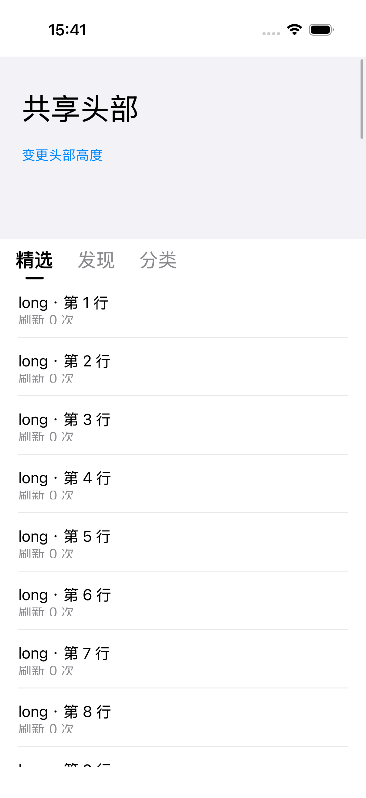
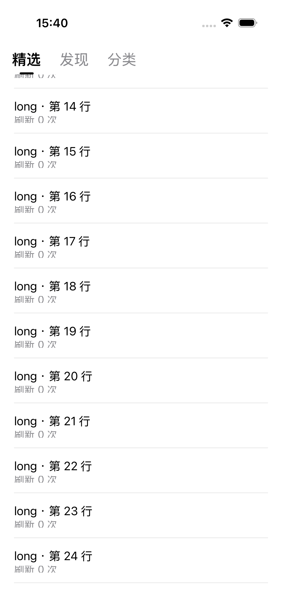

# Pager

[English](README.md) | 简体中文

基于 UIKit 的分页容器，支持页面懒创建与保留、自定义分类导航，以及共享头部与吸顶。每个页面继续使用原生纵向滚动，内容与刷新请求由业务管理。

**iOS 16+ · Swift 6 · Swift Package Manager · 无第三方依赖**

## 效果预览

以下截图来自仓库内的 UIKit 示例：

<table>
  <tr><th>头部展开</th><th>分类栏吸顶</th></tr>
  <tr>
    <td></td>
    <td></td>
  </tr>
</table>

从头部连续滚动到列表，在保留的页面之间切换，并在分类栏下方下拉刷新。短列表和空列表也能进入吸顶位置。

## 组件

Package 导出一个 library：`Pager`。

| API | 职责 |
| --- | --- |
| `PagerViewController` | 横向分页、页面懒创建与保留、子控制器生命周期转发。 |
| `PagerTabBar` | 可配置的标题、选中样式与插值指示器。 |
| `PagerNavigationPresenting` | 接入自定义导航 UIView 的协议。 |
| `StickyPagerViewController` | 共享头部、导航吸顶与各页面纵向滚动协调。 |
| `PagerControlling` | 页面选择、状态查询与事件；组合容器通过此接口暴露分页控制，不暴露页面替换。 |

## 快速开始

要求 Swift 6 / Xcode 16 或更新版本，最低 iOS 16。在 Xcode 中添加 Package，或在 `Package.swift` 中声明：

```swift
.package(url: "https://github.com/Weixi779/Pager.git", from: "0.1.0")
```

将 product 加入目标 target：

```swift
.product(name: "Pager", package: "Pager")
```

### 普通横向分页

用稳定 Id 描述页面，将下面的空控制器替换为你的业务页面：

```swift
import Pager
import UIKit

let pager = PagerViewController(pages: [
    PagerPage(id: "featured") { UIViewController() },
    PagerPage(id: "discover") { UIViewController() },
])
pager.selectPage("discover", animated: false)
```

按 UIKit 标准完成容器接入：`addChild`、添加并布局 view、`didMove(toParent:)`。页面工厂按需执行；更新页面描述时，相同 Id 继续保留原控制器，需要替换控制器本身时使用新 Id。

### 共享头部与分类栏吸顶

```swift
let sticky = StickyPagerViewController(
    pages: [
        PagerPage(id: "featured") { UITableViewController(style: .plain) },
        PagerPage(id: "discover") { UITableViewController(style: .plain) },
    ],
    items: [
        .init(id: "featured", title: "精选"),
        .init(id: "discover", title: "发现"),
    ],
    headerView: UIView(),
    headerHeight: 200,
    scrollViewProvider: { _, controller in
        (controller as! UITableViewController).tableView
    }
)

sticky.pager.selectPage("discover")
```

实际使用时替换为业务列表控制器与头部视图。上面的类型转换建立在页面工厂返回类型已知的前提上。Provider 应返回页面自己拥有、填满 viewport 的主 `UITableView`、`UICollectionView` 或 `UIScrollView`，不要再套一层纵向滚动容器。

组合容器处理安全区及自己的 inset 贡献，列表 delegate 仍由业务持有。接入后通过 `sticky.setContentInset(_:for:)` 调整业务 padding，测量得到新的头部高度后调用 `sticky.setHeaderHeight(_:)`。

### 自定义导航

```swift
var configuration = PagerTabBar.Configuration()
configuration.indicatorColor = .systemBlue
configuration.indicatorWidth = 20
configuration.itemSpacing = 24
sticky.tabBar.configuration = configuration
```

需要其他导航样式时，让自己的 UIView 实现 `PagerNavigationPresenting`，通过 `tabBar:` 初始化入口注入。默认的 `PagerTabBar` 并非强制依赖。协议及更新约定见[接入文档](Docs/Pager.md)。

### 分类栏下方刷新

在每个页面的主列表上安装 `UIRefreshControl`，处理 `.valueChanged`，请求完成后调用 `endRefreshing()`。

列表回到顶部、共享头部完全展开后，继续下拉时头部与分类栏保持原位，列表内容向下移动，刷新指示器显示在**分类栏与列表内容之间**。各页面管理自己的刷新状态，切换分类不会触发其他页面刷新。

## 行为与边界

- 初始页面 Id 必须唯一，选中 Id 必须属于页面集合，导航 Id 及顺序必须与页面一致。初始化信任调用方遵守这些契约。
- 运行时 `setPages` / `setItems` 返回 `Bool`，拒绝更新时保留原状态。组合容器通过 `sticky.setPages` 更新页面，保证导航同步。
- `selectPage` 返回 `true` 仅表示接受请求；完成与取消通过 `PagerViewControllerDelegate` 事件通知。
- 已创建页面一直保留，直到被移除或容器释放；当前版本没有 LRU 淘汰策略。
- 普通分页支持任意子控制器；吸顶协调需要显式提供 UIKit 滚动视图，不探查 SwiftUI `List` 的内部结构。
- 请求、loading 状态、内容和样式归业务所有，第三方刷新库尚未逐一验证。

## 示例与验证

```sh
open Examples/PagerDemo/PagerDemo.xcodeproj
```

**PagerDemo** 是 UIKit 示例，**PagerDemoSwiftUI** 通过 `UIViewControllerRepresentable` 承载同一个组件。示例包含长列表、短列表、空列表、头部高度变化、切页与原生刷新。

验证环境为 Xcode 26.5 / Swift 6.3.2，使用 Swift 6 language mode：iOS 16.4 上 53 个 Package 测试通过，iOS 26.5 上 18 个吸顶与原生集成相关测试通过，另有 4 条 UIKit / SwiftUI 手势测试通过。格式化及严格 lint 检查均通过。复现命令、覆盖范围及待验证事项见[验证记录](Docs/Validation.md)。

## Roadmap

0.1.0 是首个发布版本，1.0 之前 API 仍可能演进。以下是后续方向，不代表当前已有配置项，也不承诺发布时间。

- [x] UIKit 页面懒创建与保留、自定义导航、共享头部吸顶。
- [x] 分类栏下方的页面独立原生刷新，以及短列表和空列表支持。
- [x] SwiftUI 宿主示例与手势验证。
- [ ] 可复用的 SwiftUI 适配层：通过 `Binding<PagerPageId?>` 绑定选择，复用 UIKit 容器，只回写已提交的选择，避免 SwiftUI 更新造成双向回调循环。
- [ ] 通过 `UIHostingController` 接入 SwiftUI 页面内容，在视图更新时保留稳定页面身份；探索声明式头部与导航组合，避免每次渲染都重建 Pager。
- [ ] 明确 SwiftUI 吸顶布局的滚动协调边界：先评估公开滚动 API 和最低系统要求，再决定 `List` / `ScrollView` 的支持方式，不依赖私有视图树结构。
- [ ] 完善 Dynamic Type 尺寸测量，扩大 VoiceOver、从右到左布局及真机验证范围。
- [ ] 根据真实内存与页面规模需求，评估有容量限制的页面保留策略及基于 Collection 的承载方式。

SwiftUI 扩展的预期定位是 UIKit 核心之上的可选层：复用页面身份、选择与生命周期规则，业务数据加载及刷新状态继续留在应用层。

## 文档

- [接入契约与架构](Docs/Pager.md)
- [示例指南](Examples/PagerDemo/README.md)
- [验证记录](Docs/Validation.md)
- [Release Notes](https://github.com/Weixi779/Pager/releases)

## License

Pager 使用 [Apache License 2.0](LICENSE)。
